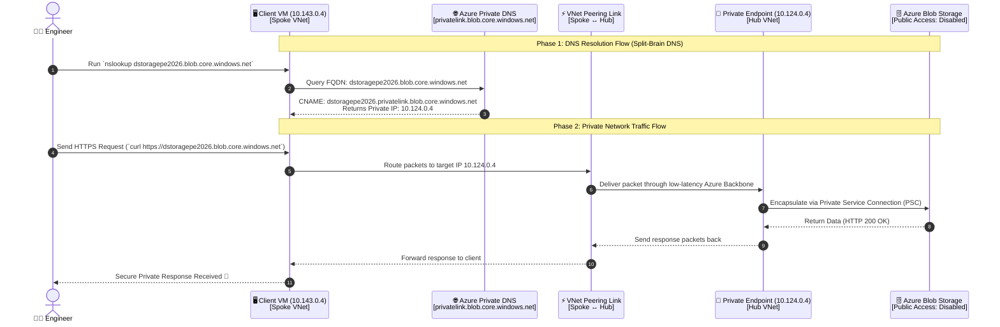
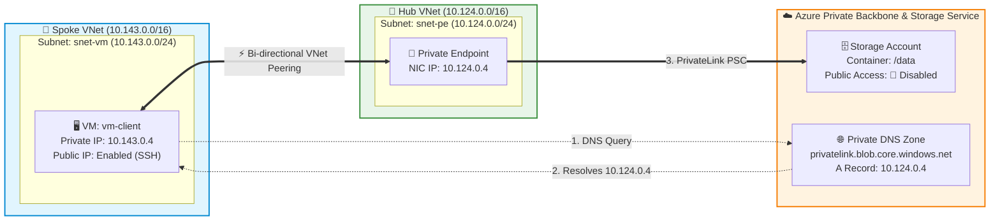

# 🚀 Azure Storage Private Endpoint with Hub-Spoke VNet Peering & Private DNS

[](https://www.terraform.io/)
[](https://portal.azure.com/)
[](LICENSE)
[](#-architecture-overview)

Production-ready Terraform implementation for securely connecting an **Azure Virtual Machine** to an **Azure Storage Account (Blob Storage)** without exposing the storage account to the public internet, using **VNet Peering**, **Azure Private Endpoint**, and **Azure Private DNS Zone**.

---

## 🎬 Private Endpoint Access Flow (Animated Visualization)

Here is how DNS resolution and packet routing flow step-by-step from the client VM across the peered network to the Storage Account:



---

## 🗺️ Animated Topology & Network Flow



---

## 📋 The 7 Architectural Steps

| Step | Component | Description |
| :---: | :--- | :--- |
| **1** | **Resource Group** | Centralized Resource Group `rg-private-endpoint-dev` in Azure Region `eastus`. |
| **2** | **2 Virtual Networks** | `vnet-vm-spoke` (`10.143.0.0/16`) & `vnet-hub` (`10.124.0.0/16`). |
| **3** | **Subnets & VM** | `snet-vm` (`10.143.0.0/24`) hosting Ubuntu Client VM (`vm-client`) with SSH NSG & PIP. |
| **4** | **VNet Peering** | High-speed, low-latency, two-way peering connecting Spoke and Hub VNets. |
| **5** | **Storage & Private Endpoint** | Storage Account (`dstoragepe2026`) with public access disabled. Private Endpoint deployed in `snet-pe` (`10.124.0.4`). |
| **6** | **Private DNS Zone** | Zone `privatelink.blob.core.windows.net` mapped with Private Endpoint IP (`10.124.0.4`). |
| **7** | **DNS Links & Testing** | Linked to both VNets for zero-config resolution; verified via `nslookup` inside VM. |

---

## 🏗️ Folder Structure (Clean Modular Pattern)

Following the DevOps standards from `adnan_devops_project`:

```text
d:\private_endpoint_github/
├── .gitignore
├── README.md
│
├── modules/                                  # 🧩 Reusable Child Modules
│   ├── resource_group/                       # RG Module (var.rg)
│   ├── vnet/                                 # VNet Module (var.vnet)
│   ├── subnet/                               # Subnet Module (var.subnet)
│   ├── peering/                              # 2-Way VNet Peering (var.peering)
│   ├── pip/                                  # Public IP Module (var.public_ip)
│   ├── nsg/                                  # Network Security Group (var.nsgs)
│   ├── virtual_machine/                      # Linux VM & NIC Module (var.vms)
│   ├── storage_account/                      # Storage Account & Container (var.storage_accounts)
│   ├── private_dns/                          # Private DNS Zone & Links (var.dns_zones, var.dns_links)
│   └── private_endpoint/                     # Private Endpoint & PSC (var.private_endpoints)
│
└── environment/                              # 🏢 Environment Root
    └── dev/                                  # Development Environment
        ├── providers.tf                      # AzureRM & Random providers
        ├── main.tf                           # Orchestrator calling all modules cleanly
        ├── variables.tf                      # Variables definitions (rg-dev, vnet-dev, etc.)
        ├── terraform.tfvars                  # Input values
        ├── terraform.tfvars.example
        └── outputs.tf                        # Clean deployment outputs
```

---

## 🚀 Step-by-Step Deployment Guide

### 1. Prerequisites
- [Terraform](https://www.terraform.io/downloads.html) >= 1.3.0
- [Azure CLI](https://learn.microsoft.com/en-us/cli/azure/install-azure-cli) installed
- Login to Azure:
  ```bash
  az login
  ```

### 2. Initialize and Deploy
```bash
# Go to dev environment
cd environment/dev

# Initialize modules & providers
terraform init

# Validate syntax & configurations
terraform validate

# Plan and review changes
terraform plan

# Apply infrastructure
terraform apply -auto-approve
```

---

## 🧪 Verification & DNS Testing

### Step 1: SSH into Client VM
Run the command provided in terraform outputs:
```bash
ssh azureuser@<VM_PUBLIC_IP>
```

### Step 2: Test DNS Resolution
Run `nslookup` for the storage account FQDN:
```bash
nslookup dstoragepe2026.blob.core.windows.net
```

**Expected Result:**
```text
Server:         127.0.0.53
Address:        127.0.0.53#53

Non-authoritative answer:
dstoragepe2026.blob.core.windows.net canonical name = dstoragepe2026.privatelink.blob.core.windows.net.
Name:   dstoragepe2026.privatelink.blob.core.windows.net
Address: 10.124.0.4   <--- Resolves directly to Private Endpoint IP!
```

### Step 3: Test Access Behavior
- **From your local machine (Outside Azure):**
  ```bash
  curl -I https://dstoragepe2026.blob.core.windows.net
  ```
  *Result: `403 Forbidden` / `AuthorizationFailure` (Public traffic is blocked).*

- **From inside the Client VM:**
  ```bash
  curl -I https://dstoragepe2026.blob.core.windows.net
  ```
  *Result: Successfully connects through the private network (`10.124.0.4`)!*

---

## 🧹 Destroy / Cleanup
To clean up and destroy all provisioned Azure resources:
```bash
terraform destroy -auto-approve
```
